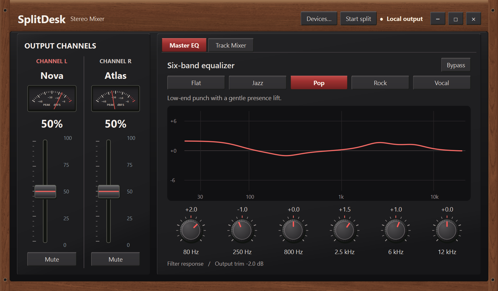

# SplitDesk Stereo

**用两台设备听一组立体声。** 把运行 Moonlight 的设备放在左边、Windows 电脑放在右边。SplitDesk 把音乐的左声道送进 Sunshine 串流，右声道留给电脑扬声器。Windows 上的调音台可以分别调节两侧音量、静音，也可以给这组音箱应用六段均衡。

**One stereo pair across two devices.** The Moonlight client plays the left channel and the Windows host plays the right. A walnut-panel mixer controls both outputs, with a six-band EQ and optional local stem playback.

[下载 Windows x64 安装包 / Download](https://github.com/Flapflops3/splitdesk-stereo/releases/latest) · [安装与排错](docs/SETUP.zh-CN.md) · [English setup guide](docs/SETUP.md)

图中 **Nova** 和 **Atlas** 是示例设备名。首次启动时填入 Moonlight 设备名称，右侧默认采用 Windows 主机名。两者都可以在 **Devices…** 里改。界面使用英文。

## 听一下声道顺序

[下载四秒立体声测试音](<Test stereo.wav?raw=true>)。启动分声道路由后，用跟随 Windows 默认输出的播放器播放。左边应该先响两声短高音，右边随后响一声较长的低音。也可以戴耳机先听原始文件，熟悉顺序。

## 五步上手

1. 准备 Windows x64、支持 `external_audio` 的 Sunshine、已配对的 Moonlight 客户端、标准 VB-CABLE 和独立的串流播放端点。验证用的串流端点是 **Steam Streaming Speakers**。
2. 下载 Release 中的 **SplitDesk-Stereo-Windows-x64.zip**，完整解压，双击 **Install.cmd**。首次安装联网获取 Python 和依赖，安装器会创建桌面快捷方式。
3. 在 **Devices** 填两侧设备名并选好四个端点，保存。按安装指南把生成的两行配置写入 Sunshine 并重启对应实例。
4. Moonlight 连接这个 Sunshine 主机并开始串流，在电脑调音台点 **Start split**。音乐播放器使用系统默认输出。
5. 播放测试音，调节两侧到相近响度。结束时点 **Stop split** 恢复 Windows 输出。

## 音色与音轨

| 预设 | 适合的起点 |
| --- | --- |
| Flat | 原始平直响应，用来比较录音和两侧音量。 |
| Jazz | 轻抬低中频和高频，保留贝斯厚度与镲片细节。 |
| Pop | 增加低频律动，略收低中频，让主唱更靠前。 |
| Rock | 给底鼓和吉他增加力度，轻收最高频。 |
| Vocal | 降低低频遮盖，突出对白和歌词。 |

EQ 在分声道之前处理，自动衰减给提升的频段留出余量。以上是可编辑的听感预设。**Track Mixer** 可以打开多音轨文件，或导入从同一时间点开始的人声、乐器分轨；普通立体声文件按原有两个声道播放。

## 适用范围

输出是两路立体声 **2.0**。35 ms 的主机延迟是调试起点，实际同步取决于客户端解码、网络和设备摆位。项目源自一台 Windows 笔记本与一台 iPad 的实机听验；其他 Moonlight 客户端可按同一音频路径自行验证。副屏显示、VPN 和 Apple Music 账号设置由各自应用管理。

[GPL-3.0-only](LICENSE) · [第三方素材与依赖](NOTICE.md)
